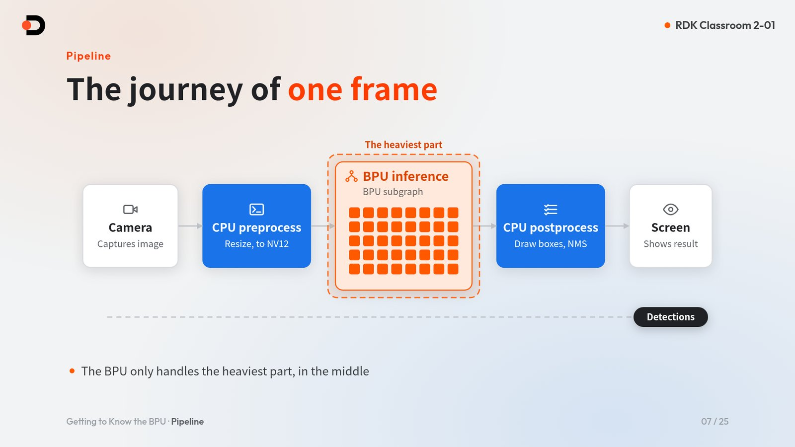
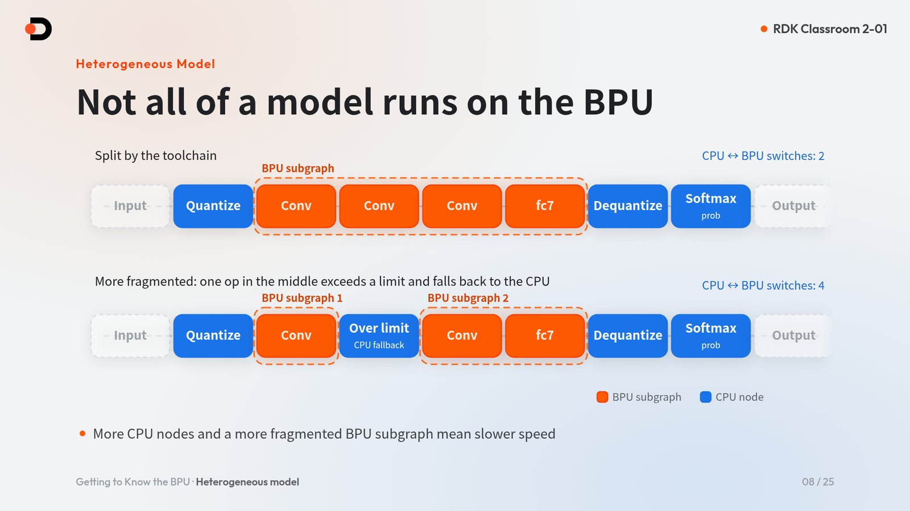
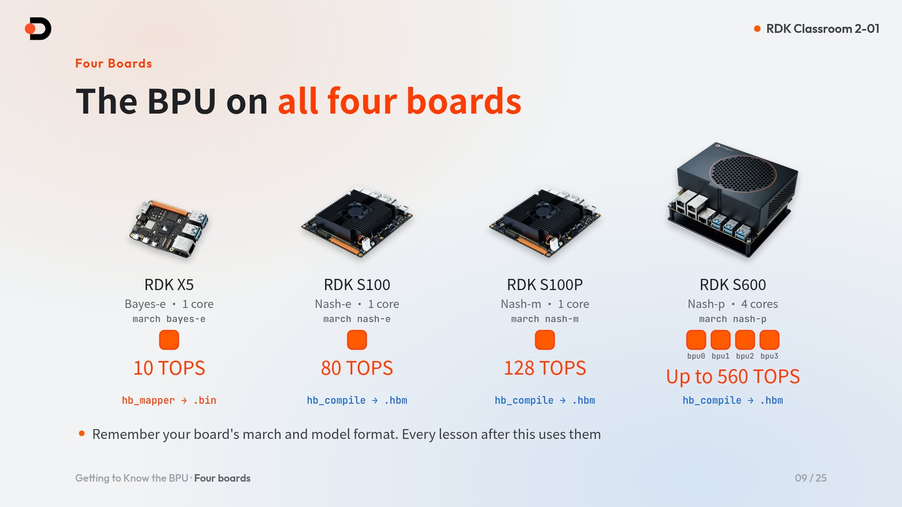
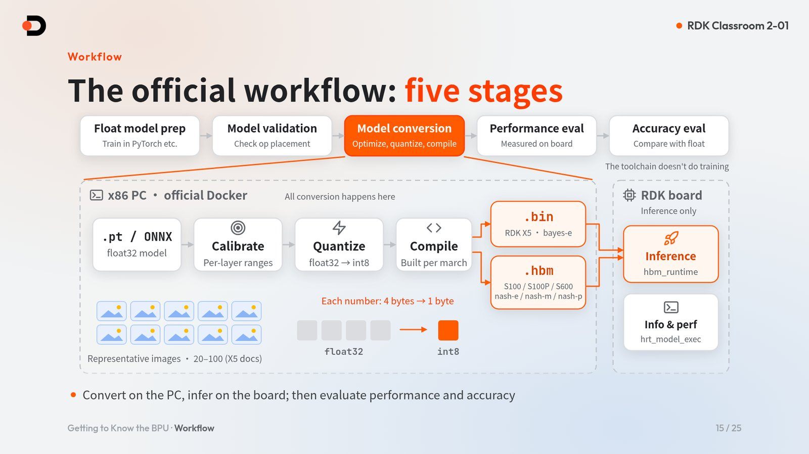

# Meet the BPU

> Course: RDK Classroom · Chapter 2 Model Zoo · Lesson 1
>
> Boards covered: RDK X5, RDK S100, RDK S100P, RDK S600 (RDK Model Zoo `main` branch)
>
> Course goal: Understand what the BPU is and how it shares work with the CPU; understand why a floating-point model must be converted and quantized before it can run on the BPU; and use `hrt_model_exec` and `hrut_somstatus` on the board to see the BPU at work
>
> Learning format: concept explanation + read-only commands on the board. No PC toolchain is needed for this lesson; you only need a board you can reach over SSH, with network access
>
> Video: [Watch on Bilibili (in Chinese)](https://www.bilibili.com/video/BV1Xnnx6jECC/)
>
> Slides: [Open English HTML slides on GitHub](https://github.com/D-Robotics/rdk-course-demos/blob/develop/02_modelzoo/01_bpu_intro/lesson-2-01.html) · [中文课件源码](https://github.com/D-Robotics/rdk-course-demos/blob/develop/02_modelzoo/01_bpu_intro/lesson-2-01.zh.html)

---

## Companion resources

| Resource | Purpose |
|---|---|
| [RDK Model Zoo](https://github.com/D-Robotics/rdk_model_zoo) | Converted models, board-side inference code, and conversion recipes |
| [ResNet sample directory](https://github.com/D-Robotics/rdk_model_zoo/tree/main/samples/vision/resnet) | The sample used in the hands-on part of this lesson |
| [RDK Resource Center](https://developer.d-robotics.cc/rdk_doc_center/en) | Official manuals for each board |
| [RDK X5 Algorithm Toolchain Development Guide](https://developer.d-robotics.cc/rdk_doc/en/04_toolchain_development) | X5 toolchain entry point; the reference for versions and environment |
| [RDK S Series Algorithm Toolchain Development Guide](https://developer.d-robotics.cc/rdk_doc/en/rdk_s/04_toolchain_development) | S100 / S100P / S600 toolchain entry point; the reference for versions and environment |
| [X5 PTQ Conversion Principle and Process](https://developer.d-robotics.cc/oe_x5_doc/en/oe_mapper/source/ptq/ptq_workflow.html) | The X5 `hb_mapper` conversion flow |
| [S Series hb_compile tool](https://developer.d-robotics.cc/oe_s_doc/en/guide/ptq/ptq_tool/hb_compile) | The S series `hb_compile` conversion tool |
| [hrt_model_exec tool introduction](https://developer.d-robotics.cc/oe_s_doc/en/guide/ucp/runtime/tool_introduction/hrt_model_exec) | Inspect models and measure performance on the board |

---

## 1. What problem does this lesson solve?

Start with a contrast: the same ResNet-18 classification model takes about 2.7 ms of pure inference on an RDK X5, and about 0.39 ms on an RDK S600.

But why can't you simply copy the `.pt` file you trained on your PC onto the board and run it? This lesson answers three questions:

1. **What is the BPU?** A unit built for neural networks. How does it share work with the CPU?
2. **Why convert and quantize?** Why must a floating-point model be quantized and compiled before it can run on the board?
3. **How do you see the BPU at work?** Use board-side commands to view model information, inference speed, and BPU usage.

---

## 2. What You Will Be Able to Do

- Explain how the CPU and BPU divide the work of processing one frame;
- Understand the "hybrid heterogeneous model": why a model is split into BPU subgraphs and CPU nodes;
- Identify each board's BPU architecture, `march`, and model format, and know why models cannot be mixed;
- Understand the basics of float32 → int8 quantization, calibration, and accuracy checks;
- Name the five stages of the official development flow and the tools used on X5 and on the S series;
- Run a read-only test on the board with `hrt_model_exec model_info / perf` and `hrut_somstatus`.

---

## 3. What the BPU is and why it exists

BPU stands for **Brain Processing Unit**. It is the unit in D-Robotics chips dedicated to accelerating neural network inference.

The heaviest part of neural network inference is fixed-point math such as convolution and matrix multiplication, repeated over and over. The CPU is good at general-purpose logic but not at doing the same operation many thousands of times; the BPU is built around an array of multiply-accumulate (MAC) units designed for exactly that.

| | CPU | BPU |
|---|---|---|
| Good at | General logic, branching | Fixed-point math such as convolution and matrix multiplication |
| Role in a vision app | Pre-processing (resizing, color-format conversion) and post-processing (drawing boxes, NMS) | The heaviest part of neural network inference |

!!! note "About the GPU"
    The RDK S100 also has a Mali-G78AE GPU, but it is not the focus of this chapter. Model acceleration in this chapter always means the BPU.

### 3.1 How one frame gets processed



Take camera-based detection as an example. One frame passes through this pipeline:

1. The **camera** captures an image;
2. **CPU pre-processing**: resize and convert to NV12;
3. **BPU inference**: run the model's BPU subgraph;
4. **CPU post-processing**: draw boxes, NMS;
5. The **screen** shows the result.

The BPU handles only the heaviest stage in the middle; both ends still run on the CPU. So end-to-end frame rate depends not only on the BPU but also on how well pre- and post-processing are written.

---

## 4. Hybrid heterogeneous models: not everything runs on the BPU



When the toolchain converts a model, it splits it into **BPU subgraphs** and **CPU nodes**. Such a model is called a **hybrid heterogeneous model**. Using ResNet-18 as an example:

- The Conv … fc7 layers in the middle form one BPU subgraph that runs on the BPU;
- Quantize at the input, Dequantize at the output, and Softmax (prob) run on the CPU;
- There are only **2** CPU ↔ BPU switches in total.

If an operator in the middle exceeds the BPU's limits, it falls back to the CPU and splits the single BPU subgraph into two, raising the number of switches to **4**. Each switch costs data movement: **the more CPU nodes and the more fragmented the BPU subgraphs, the slower the model runs.**

You can see where each operator lands with the toolchain's checker tool on the PC; it lists the placement of every operator (see Sections 7 and 8).

---

## 5. The four boards' BPUs



| Board | BPU architecture | `march` | BPU cores | Compute | Conversion tool → model format |
|---|---|---|---|---|---|
| RDK X5 | Bayes-e | `bayes-e` | 1 | 10 TOPS | `hb_mapper` → `.bin` |
| RDK S100 | Nash-e | `nash-e` | 1 | 80 TOPS | `hb_compile` → `.hbm` |
| RDK S100P | Nash-m | `nash-m` | 1 | 128 TOPS | `hb_compile` → `.hbm` |
| RDK S600 | Nash-p | `nash-p` | 4 (bpu0–bpu3) | Up to 560 TOPS | `hb_compile` → `.hbm` |

The three S series boards (S100, S100P, S600) share the same toolchain image. For the exact toolchain and image versions, **see the toolchain docs**.

**Remember your board's `march` and model format; every later lesson uses them.**

### 5.1 Model formats cannot be mixed

- An X5 `.bin` will not run on the S series;
- An S100P cannot use an S100 `.hbm` either: `nash-e` and `nash-m` are different `march` values;
- Never rename a `.hbm` to `.bin` to pass it off as one.

Model inputs also differ between boards. For the Model Zoo ResNet-18:

| Board | Input |
|---|---|
| RDK X5 | 1 input: one packed NV12 tensor, `1×3×224×224` |
| S series | 2 inputs: a Y plane `(1, 224, 224, 1)` and a UV plane `(1, 112, 112, 2)` |

For the exact input names and shapes, go by the output of `hrt_model_exec model_info` on the board (see Section 9.3).

!!! note "Exception"
    X5 can also produce a `.hbm` through the QAT route. This chapter does not cover it.

---

## 6. Conversion and quantization: why a .pt can't run on the board

The model you train on a PC is a **float32 floating-point model**, while the BPU runs **int8 fixed-point math** and needs a model compiled for its specific architecture (`march`). So the model must first be converted: optimized, quantized, and compiled.

### 6.1 float32 → int8

| | float32 | int8 |
|---|---|---|
| Size per number | 4 bytes | 1 byte |
| Representable values | Continuous floating-point | 256 levels |

Each number shrinks from 4 bytes to 1 byte, and the math can run on the BPU's fixed-point MAC array. According to the official documentation, the accuracy loss after quantization is **within 1%** for most typical models.

### 6.2 Calibration: telling quantization each layer's range

int8 has only 256 levels, so before quantizing you need to know roughly what range each layer's values fall in. This step is called **calibration**: run a batch of representative images through the floating-point model and record each layer's value distribution.

- The X5 docs suggest 20–100 calibration images;
- The Model Zoo ResNet conversion uses a fixed set of 200 COCO images.

### 6.3 Always check accuracy after quantization

"Conversion succeeded" does not mean "accuracy is acceptable". Check at two levels:

- **Cosine similarity per output node**: the Model Zoo standard is ≥ 0.999 for every output node, and never below 0.99;
- **Task accuracy**, such as ResNet-18 Top-1.

| ResNet-18 | Top-1 |
|---|---|
| Floating-point model | 59.35% |
| On RDK X5 | 58.91% |
| On RDK S100 | 58.79% |

### 6.4 PTQ or QAT?

- **PTQ (post-training quantization)** is the default main path: no retraining, just quantize directly with calibration data;
- **QAT (quantization-aware training)** requires retraining and has a higher bar. Consider it only if accuracy still falls short after tuning PTQ.

---

## 7. The official five-stage development flow



The official flow divides model deployment into five stages:

1. **Float model preparation**: train the model in PyTorch or a similar framework. The toolchain does not do training;
2. **Model validation**: check operator placement to see which operators can go on the BPU;
3. **Model conversion**: optimize, quantize, compile;
4. **Performance evaluation**: measure speed on the board;
5. **Accuracy evaluation**: compare accuracy against the floating-point model.

The conversion chain is: PyTorch → ONNX (float32) → calibrate → quantize → compile per `march` → `.bin` for X5, `.hbm` for the S series.

!!! warning "Convert on the PC, infer on the board"
    All conversion happens in the official Docker on an x86 PC. The board only runs inference: `hbm_runtime` for inference, and `hrt_model_exec` to inspect models and measure performance.

### 7.1 Tools for each step

| Step | RDK X5 | S series (S100 / S100P / S600) |
|---|---|---|
| Export | PyTorch → ONNX | PyTorch → ONNX |
| Model check | `hb_mapper checker --march bayes-e` | `hb_compile -m <model> --march nash-*` |
| Quantize + compile | `hb_mapper makertbin` → `.bin` | `hb_config_generator` + `hb_compile -c` → `.hbm` |
| On-board inference | Python `hbm_runtime` or the C/C++ API | Same |

For toolchain versions and Docker images, **see the toolchain docs**: [RDK X5 Algorithm Toolchain Development Guide](https://developer.d-robotics.cc/rdk_doc/en/04_toolchain_development) · [RDK S Series Algorithm Toolchain Development Guide](https://developer.d-robotics.cc/rdk_doc/en/rdk_s/04_toolchain_development).

---

## 8. What Model Zoo saves you

RDK Model Zoo saves you three things along this chain:

| What it saves | Details |
|---|---|
| Converted models | Most samples offer `.bin` / `.hbm` downloads that are ready to run |
| Board-side inference code | Pre-processing, inference, and post-processing code is already written |
| Conversion recipes | Follow the `conversion/` directory to convert your own model |

Take `samples/vision/resnet/` as an example: it contains `model/`, `conversion/`, and `runtime/`, which map to the three parts of the rest of this chapter.

Since RDK Model Zoo v2.0.0, RDK X5, RDK S100, RDK S100P, and RDK S600 all use the `main` branch. There is one codebase, but models are still board-specific: `.bin` for X5 and `.hbm` for the S series. At run time, choose the board with the `--target` or `--platform` option declared in each sample's README.

### 8.1 Operator placement and fallback

When you bring your own model to the board, two kinds of operator problems come up most often:

| Case | Symptom | What to do |
|---|---|---|
| Unsupported operator | The checker fails with `HorizonRT not support these cpu operators` | Check the operator constraint list, or use a custom operator |
| Operator beyond BPU limits | For example, a shape (C×H×W) above 8192 falls back to the CPU | It runs, but the BPU subgraph is split; CPU ↔ BPU switches go from 2 to 4 and the model slows down |

**Whether a model can run on the board and how fast it runs there are two different questions.** Checking operator placement with the checker before conversion saves far more time than hunting for the cause afterwards.

---

## 9. Hands-on: see the BPU at work

All commands in this section are read-only and work on all four boards. Log in to the board's terminal and run them in order.

### 9.1 Identify your board

Check how many BPU cores there are:

```bash
cat /sys/devices/system/bpu/core_num
ls /sys/devices/system/bpu/
```

X5, S100, and S100P print `1`; S600 prints `4`, and you can see four directories, `bpu0` to `bpu3`.

Check the board identity:

```bash
cat /sys/class/boardinfo/soc_name /sys/class/socinfo/soc_name 2>/dev/null | tr -d '\0'
```

X5 prints one of `X5U`, `X5H`, or `X5M`; the S series prints `S100`, `S100P`, or `S600`. Model Zoo samples select the board through the `--target` / `--platform` option declared in each README; samples whose README offers `--target auto` identify the board automatically from this kind of hardware identity.

### 9.2 Download the ResNet-18 model

Clone Model Zoo on the board and run the download script from the **repository root**:

```bash
git clone https://github.com/D-Robotics/rdk_model_zoo.git
cd rdk_model_zoo
bash samples/vision/resnet/model/download.sh x5 18
```

For another board, change `x5` to `s100`, `s100p`, or `s600`. X5 gets `resnet18_bayese_224x224_nv12.bin`; the S series boards get the matching `.hbm` (with `nashe` / `nashm` / `nashp` in the file name).

### 9.3 View model information

```bash
hrt_model_exec model_info --model_file <model_file>
```

`hrt_model_exec` is preinstalled on all four boards; there is nothing extra to install. In the output, look at:

- `input[...]`: input names and `valid shape` (compare with Section 5.1: one NV12 input on X5, separate Y and UV inputs on the S series);
- `output[...]`: ResNet-18 outputs a 1000-class result, `valid shape: (1,1000)`;
- `MARCH` in `[model desc]`: it should match your board.

### 9.4 Measure pure inference performance

```bash
hrt_model_exec perf --model_file <model_file> --frame_count=200
```

The syntax is the same on all four boards. In the `Perf result` at the end of the output, focus on two lines: `Average latency` (average per-frame latency) and `Frame rate`.

To measure throughput under concurrency, add `--thread_num=<N>`:

!!! note "Key point"
    `--thread_num=<N>` is the number of concurrent test threads, not the number of cores: 1–8 on X5, 1–32 on the S series. For a multi-core model, use `--core_id` to specify the same number of cores as `core_num`. `core_id` numbering starts at 1, and 1 means bpu0.

### 9.5 Check BPU usage

While `perf` is running, **open a second terminal** and run:

```bash
# RDK X5
hrut_somstatus

# RDK S100 / S100P
hrut_somstatus | grep -A4 -i "bpu status"

# RDK S600 (lists bpu0..bpu3 separately)
hrut_somstatus | grep -A6 -i "bpu status"
```

On X5, read the `bpu status` section directly; the S series output is longer, so filter it with `grep`. Here is one sample measured on the S600 while a 4-thread `perf` run was in progress:

```text
bpu status information---->
		ratio
	bpu0: 	70
	bpu1: 	64
	bpu2: 	41
	bpu3: 	18
```

Check again after `perf` finishes and every core's usage drops back to 0.

### 9.6 Reading the results

**Model Zoo README reference: ResNet-18 average per-frame latency** (measured with the CPU governor in performance mode)

| Board | Average latency |
|---|---|
| RDK X5 | 2.740 ms |
| RDK S100 | 0.631 ms |
| RDK S100P | 0.534 ms |
| RDK S600 | 0.394 ms |

If your results are far off, first check that the CPU is in performance mode.

**Measured on S600 · ResNet-18** (`--frame_count=200`)

| `--thread_num` | Average latency | Frame rate |
|---|---|---|
| 1 | 0.387 ms | 2508 FPS |
| 4 | 0.522 ms | 7440 FPS |
| 12 | 0.927 ms | 12512 FPS |

More threads give higher total throughput, while per-inference latency rises slightly. In deployment, choose your concurrency based on whether the application cares more about latency or throughput.

---

## 10. Five rules for beginners

1. **`march` and model format map one to one**: never reuse models, Runtime, or wheels across platforms;
2. **PTQ first; move to QAT only if PTQ falls short**;
3. **Convert in the official Docker on an x86 PC**;
4. **Check operator placement with the checker first, then prepare calibration data and the YAML config**;
5. **Test performance and accuracy after every conversion**; don't stop at "conversion succeeded". On the board, use the system `hbm_runtime`, not the PyPI package of the same name.

---

## 11. Frequently Asked Questions

### Q1: Can I copy a .pt trained on my PC straight onto the board?

No. The BPU only runs models that have been quantized and compiled for the board's `march`: `.bin` on X5 and `.hbm` on the S series. Convert the model in the official Docker on a PC first, or use a converted model from Model Zoo.

### Q2: Can an S100 .hbm be used on an S100P or S600?

No. The `march` values of S100, S100P, and S600 are `nash-e`, `nash-m`, and `nash-p`, and a model must be compiled for each. When you use the Model Zoo download script, pass the matching board argument to get the right model.

### Q3: The conversion succeeded, so why isn't it fast?

Whether a model can run on the board and how fast it runs are two different questions. If operators fall back to the CPU, the BPU subgraph is split and CPU ↔ BPU switches increase. Check operator placement with the checker, and check that the board's CPU is in performance mode.

### Q4: Does `--thread_num=4` mean four BPU cores are used?

No. `--thread_num` is the number of concurrent test threads, not the number of cores. For a multi-core model, use `--core_id` to specify the same number of cores as `core_num`.

### Q5: Do I need to install the toolchain for this lesson's hands-on part?

No. This lesson only runs read-only commands on the board; `hrt_model_exec` and `hrut_somstatus` are preinstalled. A board you can reach over SSH, with network access, is all you need.

---

## Lesson Summary

- The BPU is a unit dedicated to accelerating neural network inference: the CPU handles general logic and pre/post-processing, while the BPU handles the heaviest fixed-point math;
- A converted model is a hybrid heterogeneous model; the more CPU nodes and the more fragmented the BPU subgraphs, the slower it runs;
- Each of the four boards has its own `march`: `.bin` for X5, `.hbm` for the S series, and models cannot be mixed;
- A floating-point model needs calibration, int8 quantization, and compilation before it can run on the board, and accuracy must be checked afterwards;
- Conversion happens in the official Docker on a PC; the board only runs inference;
- Model Zoo provides converted models, board-side code, and conversion recipes, and since v2.0.0 all four boards use the `main` branch.

## Completion Checklist

- [ ] I can name my board's BPU architecture, `march`, core count, and model format;
- [ ] I can explain why a `.pt` cannot run directly on the board;
- [ ] I downloaded the ResNet-18 model that matches my board with `download.sh`;
- [ ] I viewed the model's inputs and outputs with `hrt_model_exec model_info`;
- [ ] I measured `Average latency` and `Frame rate` with `hrt_model_exec perf` and compared them with the README reference;
- [ ] I watched BPU usage change in a second terminal with `hrut_somstatus`.

## Extension Exercises

1. Run `perf` with different `--thread_num` values and record how `Average latency` and `Frame rate` change;
2. Run `hrut_somstatus` several times while `perf` is running and watch how BPU usage changes as the test starts and ends;
3. Read the algorithm toolchain development guide for your board, find the description of the checker tool, and see how it lists operator placement.

## Appendix: Command Quick Reference

```bash
# BPU core count
cat /sys/devices/system/bpu/core_num

# Board identity
cat /sys/class/boardinfo/soc_name /sys/class/socinfo/soc_name 2>/dev/null | tr -d '\0'

# Download ResNet-18 (from the rdk_model_zoo repository root; replace x5 with s100 / s100p / s600)
bash samples/vision/resnet/model/download.sh x5 18

# Model information
hrt_model_exec model_info --model_file <model_file>

# Pure inference performance
hrt_model_exec perf --model_file <model_file> --frame_count=200

# BPU usage (run directly on X5; use -A4 on S100 / S100P and -A6 on S600)
hrut_somstatus
hrut_somstatus | grep -A6 -i "bpu status"
```

The next lesson covers **Opening Model Zoo**: how the `main` branch supports all four boards with one codebase, running your first sample, and seeing ResNet-18 output `white wolf`.
