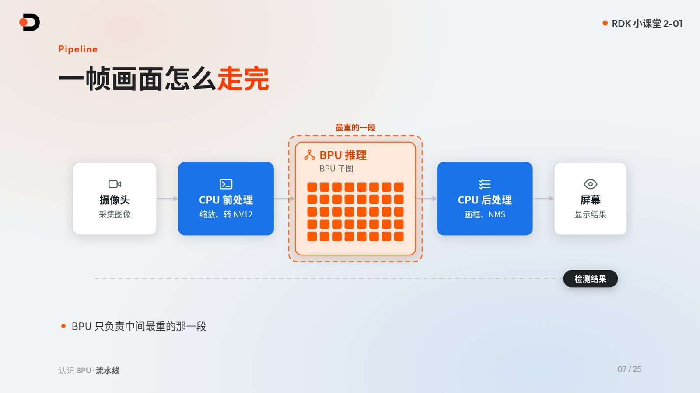
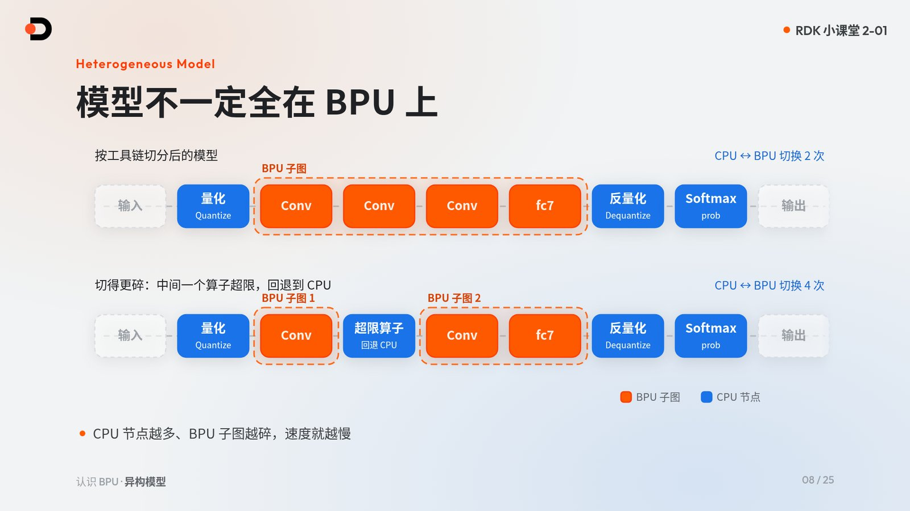
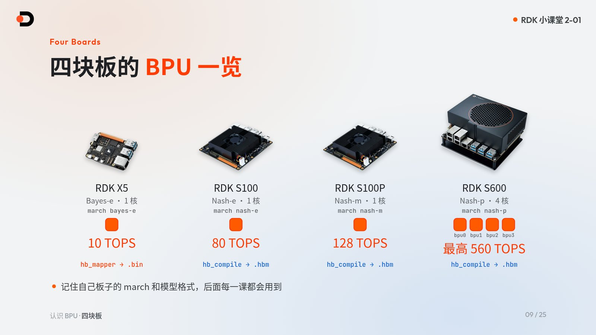
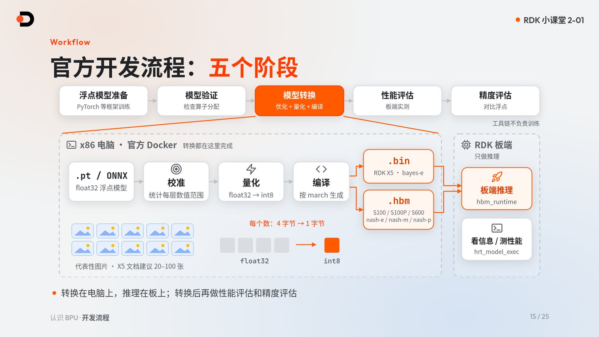

# 认识 BPU

> 所属章节：RDK 小课堂 · 第 2 章 Model Zoo · 第 1 课
>
> 适用板卡：RDK X5、RDK S100、RDK S100P、RDK S600（RDK Model Zoo `main` 分支）
>
> 课程目标：理解 BPU 是什么、它和 CPU 怎么分工；理解浮点模型为什么必须先转换、量化，才能在 BPU 上运行；在板上用 `hrt_model_exec` 和 `hrut_somstatus` 亲眼看到 BPU 在工作
>
> 学习方式：概念讲解 + 板端只读命令实操。本课不需要电脑端工具链，板子能 SSH 登录、能联网即可
>
> 配套视频：<!-- TODO: B 站视频发布后补充链接 -->**待发布**（B 站链接发布后补充）
>
> 配套课件：[查看中文 HTML 课件源码](https://github.com/D-Robotics/rdk-course-demos/blob/develop/02_modelzoo/01_bpu_intro/lesson-2-01.zh.html) · [English slide source](https://github.com/D-Robotics/rdk-course-demos/blob/develop/02_modelzoo/01_bpu_intro/lesson-2-01.html)

---

## 配套资源

| 资源 | 用途 |
|---|---|
| [RDK Model Zoo](https://github.com/D-Robotics/rdk_model_zoo) | 获取转换好的模型、板端推理代码和转换配方 |
| [ResNet 示例目录](https://github.com/D-Robotics/rdk_model_zoo/tree/main/samples/vision/resnet) | 本课上板实操使用的示例 |
| [RDK 文档资源中心](https://developer.d-robotics.cc/rdk_doc_center/) | 查各板卡官方手册 |
| [RDK X5 算法工具链开发指南](https://developer.d-robotics.cc/rdk_doc/04_toolchain_development) | X5 工具链入口，版本与环境以此为准 |
| [RDK S 系列算法工具链开发指南](https://developer.d-robotics.cc/rdk_doc/rdk_s/04_toolchain_development) | S100 / S100P / S600 工具链入口，版本与环境以此为准 |
| [X5 PTQ 转换原理及流程](https://developer.d-robotics.cc/oe_x5_doc/cn/oe_mapper/source/ptq/ptq_workflow.html) | X5 `hb_mapper` 转换流程 |
| [S 系列 hb_compile 工具](https://developer.d-robotics.cc/oe_s_doc/guide/ptq/ptq_tool/hb_compile) | S 系列 `hb_compile` 转换工具 |
| [hrt_model_exec 工具介绍](https://developer.d-robotics.cc/oe_s_doc/guide/ucp/runtime/tool_introduction/hrt_model_exec) | 板端查看模型信息、测性能 |

---

## 1. 本课要解决什么问题

先看一个反差：同一个 ResNet-18 分类模型，在 RDK X5 上纯推理约 2.7 ms，在 RDK S600 上约 0.39 ms。

可是，你在电脑上训练好的 `.pt` 文件，为什么不能直接拷到板子上跑？这节课围绕三个问题展开：

1. **BPU 是什么**：专门跑神经网络的单元，它和 CPU 怎么分工？
2. **为什么要转换 + 量化**：浮点模型为什么要先量化、编译，才能上板？
3. **怎么看到 BPU 干活**：在板上用命令查看模型信息、推理速度和 BPU 使用率。

---

## 2. 完成本课后你能做到什么

- 说清 CPU 和 BPU 在一帧画面处理中的分工；
- 理解“混合异构模型”：为什么一个模型会被切成 BPU 子图和 CPU 节点；
- 认出四块板各自的 BPU 架构、`march` 和模型格式，知道模型为什么不能混用；
- 理解 float32 → int8 量化、校准和精度检查的基本概念；
- 说出官方五阶段开发流程，以及 X5 与 S 系列各用什么工具；
- 在板上用 `hrt_model_exec model_info / perf` 和 `hrut_somstatus` 完成一次只读实测。

---

## 3. BPU 是什么，为什么需要它

BPU 是 **Brain Processing Unit** 的缩写，是 D-Robotics 芯片里专门加速神经网络推理的单元。

神经网络推理里最重的是卷积、矩阵乘这类大量重复的定点计算。CPU 擅长通用逻辑，但不擅长这种“同一种运算重复成千上万次”的工作；BPU 内部是一组乘加（MAC）阵列，正好为它而生。

| | CPU | BPU |
|---|---|---|
| 擅长 | 通用逻辑、分支判断 | 卷积、矩阵乘等定点计算 |
| 在视觉应用里负责 | 前处理（缩放、颜色格式转换）、后处理（画框、NMS） | 神经网络推理中最重的那一段 |

!!! note "关于 GPU"
    RDK S100 上还有 Mali-G78AE GPU，但它不是本章的重点。本章说的模型加速，指的都是 BPU。

### 3.1 一帧画面怎么走完



以摄像头检测为例，一帧画面的流水线是：

1. **摄像头**采集图像；
2. **CPU 前处理**：缩放，转成 NV12；
3. **BPU 推理**：运行模型中的 BPU 子图；
4. **CPU 后处理**：画框、NMS；
5. **屏幕**显示结果。

BPU 只负责中间最重的那一段，前后两头仍然由 CPU 完成。所以端到端帧率不只取决于 BPU，前后处理写得好不好同样重要。

---

## 4. 混合异构模型：模型不一定全在 BPU 上



工具链转换模型时，会把模型切成 **BPU 子图** 和 **CPU 节点**，这样的模型叫作 **混合异构模型**。以 ResNet-18 为例：

- 中间的 Conv … fc7 组成一个 BPU 子图，在 BPU 上运行；
- 输入端的量化（Quantize）、输出端的反量化（Dequantize）和 Softmax（prob）在 CPU 上运行；
- 整个过程只有 **2 次** CPU ↔ BPU 切换。

如果中间某个算子超出 BPU 的限制，它就会回退到 CPU，把原来的一个 BPU 子图切成两个，切换次数变成 **4 次**。每次切换都有数据搬运开销：**CPU 节点越多、BPU 子图越碎，速度就越慢。**

每个算子最终落在 BPU 还是 CPU，可以在 PC 上用工具链的 checker 工具查看，它会逐个列出算子的分配情况（详见第 7、8 节）。

---

## 5. 四块板的 BPU



| 板卡 | BPU 架构 | `march` | BPU 核数 | 算力 | 转换工具 → 模型格式 |
|---|---|---|---|---|---|
| RDK X5 | Bayes-e | `bayes-e` | 1 | 10 TOPS | `hb_mapper` → `.bin` |
| RDK S100 | Nash-e | `nash-e` | 1 | 80 TOPS | `hb_compile` → `.hbm` |
| RDK S100P | Nash-m | `nash-m` | 1 | 128 TOPS | `hb_compile` → `.hbm` |
| RDK S600 | Nash-p | `nash-p` | 4（bpu0–bpu3） | 最高 560 TOPS | `hb_compile` → `.hbm` |

S100、S100P、S600 三块 S 系列板共用同一套工具链镜像；具体工具链与镜像版本**以工具链文档为准**。

**记住自己板子的 `march` 和模型格式，后面每一课都会用到。**

### 5.1 模型格式不能混用

- X5 的 `.bin` 不能在 S 系列上跑；
- S100P 也不能用 S100 的 `.hbm`：`nash-e` 和 `nash-m` 是不同的 `march`；
- 禁止把 `.hbm` 改后缀冒充 `.bin`。

不同板子的模型输入也不一样。以 Model Zoo 的 ResNet-18 为例：

| 板卡 | 输入 |
|---|---|
| RDK X5 | 1 个输入：一个 packed NV12 张量，`1×3×224×224` |
| S 系列 | 2 个输入：Y 平面 `(1, 224, 224, 1)` 和 UV 平面 `(1, 112, 112, 2)` |

具体的输入名称和形状，以板上 `hrt_model_exec model_info` 的输出为准（见第 9.3 节）。

!!! note "例外"
    X5 走 QAT 路线时也会产出 `.hbm`，本章不展开。

---

## 6. 转换与量化：为什么 .pt 不能直接上板

电脑上训练出的模型是 **float32 浮点模型**，而 BPU 跑的是 **int8 定点计算**，并且需要针对具体芯片架构（`march`）编译。所以模型必须先经过转换：优化、量化、编译。

### 6.1 float32 → int8

| | float32 | int8 |
|---|---|---|
| 每个数占用 | 4 字节 | 1 字节 |
| 可表示的取值 | 连续浮点数 | 256 个等级 |

每个数从 4 字节缩小到 1 字节，计算也能交给 BPU 的定点乘加阵列。按官方说明，大多数典型模型量化后的精度损失在 **1% 以内**。

### 6.2 校准：让量化知道每层的数值范围

int8 只有 256 个等级，量化前必须知道每一层数值大致落在什么范围，这一步叫**校准**：用一批有代表性的图片跑一遍浮点模型，统计各层的数值分布。

- X5 文档建议准备 20–100 张校准图片；
- Model Zoo 的 ResNet 转换固定使用 200 张 COCO 图片。

### 6.3 量化后一定要检查精度

“转换成功”不等于“精度可用”。检查有两个层面：

- **逐输出节点的余弦相似度**：Model Zoo 的标准是每个输出节点 ≥ 0.999，且绝不能低于 0.99；
- **任务精度**：例如 ResNet-18 的 Top-1。

| ResNet-18 | Top-1 |
|---|---|
| 浮点模型 | 59.35% |
| RDK X5 板端 | 58.91% |
| RDK S100 板端 | 58.79% |

### 6.4 PTQ 还是 QAT

- **PTQ（训练后量化）**是默认主路径：不需要重新训练，用校准数据直接量化；
- **QAT（量化感知训练）**需要重新训练，门槛更高。只有在 PTQ 调优后精度仍然不达标时才考虑。

---

## 7. 官方五阶段开发流程



官方把模型部署分成五个阶段：

1. **浮点模型准备**：在 PyTorch 等框架中训练好模型。工具链本身不负责训练；
2. **模型验证**：检查算子分配，看哪些算子能上 BPU；
3. **模型转换**：优化、量化、编译；
4. **性能评估**：在板上实测速度；
5. **精度评估**：与浮点模型对比精度。

转换链路是：PyTorch → ONNX（float32）→ 校准 → 量化 → 按 `march` 编译 → X5 得到 `.bin`，S 系列得到 `.hbm`。

!!! warning "转换在 PC 上，推理在板上"
    所有转换都在 x86 PC 的官方 Docker 里完成。板子只负责推理：用 `hbm_runtime` 推理，用 `hrt_model_exec` 查看模型信息和测性能。

### 7.1 每一步用什么工具

| 步骤 | RDK X5 | S 系列（S100 / S100P / S600） |
|---|---|---|
| 导出 | PyTorch → ONNX | PyTorch → ONNX |
| 模型检查 | `hb_mapper checker --march bayes-e` | `hb_compile -m <模型> --march nash-*` |
| 量化 + 编译 | `hb_mapper makertbin` → `.bin` | `hb_config_generator` + `hb_compile -c` → `.hbm` |
| 板端推理 | Python `hbm_runtime` 或 C/C++ API | 同左 |

具体工具链版本和 Docker 镜像**以工具链文档为准**：[RDK X5 算法工具链开发指南](https://developer.d-robotics.cc/rdk_doc/04_toolchain_development) · [RDK S 系列算法工具链开发指南](https://developer.d-robotics.cc/rdk_doc/rdk_s/04_toolchain_development)。

---

## 8. Model Zoo 帮你省掉什么

RDK Model Zoo 在这条链路上主要帮你省掉三件事：

| 省掉的事 | 说明 |
|---|---|
| 转换好的模型 | 大多数 Sample 提供 `.bin` / `.hbm` 下载，拿来就能跑 |
| 板端推理代码 | 前处理、推理、后处理代码都已写好 |
| 转换配方 | `conversion/` 目录可以照着转自己的模型 |

以 `samples/vision/resnet/` 为例，目录里是 `model/`、`conversion/`、`runtime/` 三个文件夹，正好对应本章后面的三个板块。

自 RDK Model Zoo v2.0.0 起，RDK X5、RDK S100、RDK S100P、RDK S600 统一使用 `main` 分支。代码一套，模型仍按板卡区分：X5 使用 `.bin`，S 系列使用 `.hbm`。运行时按各示例 README 声明的 `--target` 或 `--platform` 选择板卡。

### 8.1 算子分配与回退

把自己的模型转上板时，最常遇到两类算子问题：

| 情况 | 现象 | 处理 |
|---|---|---|
| 不支持的算子 | checker 直接报错：`HorizonRT not support these cpu operators` | 查算子约束列表，或改用自定义算子 |
| 超出 BPU 限制的算子 | 例如 shape（C×H×W）超过 8192，回退到 CPU | 能跑，但 BPU 子图被切碎，CPU ↔ BPU 切换从 2 次变成 4 次，速度变慢 |

**能不能上板，和上板之后快不快，是两回事。** 所以转换前先用 checker 看算子分配，比转换完再找原因省事得多。

---

## 9. 上板实操：亲眼看到 BPU 干活

本节命令都是只读的，四块板通用。登录板子的终端后依次执行。

### 9.1 先认清手上的板子

查看 BPU 有几个核：

```bash
cat /sys/devices/system/bpu/core_num
ls /sys/devices/system/bpu/
```

X5、S100、S100P 输出 `1`；S600 输出 `4`，并能看到 `bpu0` 到 `bpu3` 四个目录。

查看板卡身份：

```bash
cat /sys/class/boardinfo/soc_name /sys/class/socinfo/soc_name 2>/dev/null | tr -d '\0'
```

X5 输出 `X5U`、`X5H`、`X5M` 之一；S 系列分别输出 `S100`、`S100P`、`S600`。Model Zoo 示例的板卡选择以各 README 声明的 `--target` / `--platform` 为准；README 提供 `--target auto` 的示例，会根据这类硬件身份信息自动识别板卡。

### 9.2 下载 ResNet-18 模型

在板上克隆 Model Zoo，并在**仓库根目录**执行下载脚本：

```bash
git clone https://github.com/D-Robotics/rdk_model_zoo.git
cd rdk_model_zoo
bash samples/vision/resnet/model/download.sh x5 18
```

换板时把 `x5` 改成 `s100`、`s100p` 或 `s600`。X5 会得到 `resnet18_bayese_224x224_nv12.bin`；S 系列得到对应的 `.hbm`（文件名中分别是 `nashe` / `nashm` / `nashp`）。

### 9.3 查看模型信息

```bash
hrt_model_exec model_info --model_file <模型文件>
```

四块板都已预装 `hrt_model_exec`，不用另外安装。输出里重点看：

- `input[...]`：输入名称、`valid shape`（对照第 5.1 节：X5 一个 NV12 输入，S 系列 Y、UV 两个输入）；
- `output[...]`：ResNet-18 的输出是 1000 类分类结果，`valid shape: (1,1000)`；
- `[model desc]` 中的 `MARCH`：应与你的板子一致。

### 9.4 测纯推理性能

```bash
hrt_model_exec perf --model_file <模型文件> --frame_count=200
```

四块板语法一致。输出末尾的 `Perf result` 里重点看两行：`Average latency`（平均单帧延时）和 `Frame rate`（帧率）。

想测并发下的吞吐，可以加 `--thread_num=<N>`：

!!! note "要点"
    `--thread_num=<N>` 是并发测试线程数，不是核数：X5 1–8，S 系列 1–32。多核模型要用 `--core_id` 指定与 `core_num` 相同数量的核。`core_id` 从 1 开始编号，1 就是 bpu0。

### 9.5 查看 BPU 使用率

`perf` 运行的同时，**另开一个终端**执行：

```bash
# RDK X5
hrut_somstatus

# RDK S100 / S100P
hrut_somstatus | grep -A4 -i "bpu status"

# RDK S600（分别列出 bpu0..bpu3）
hrut_somstatus | grep -A6 -i "bpu status"
```

X5 直接看 `bpu status` 那一段；S 系列输出较长，用 `grep` 过滤即可。下面是实测 S600 在 4 线程 `perf` 运行期间的一次采样：

```text
bpu status information---->
		ratio
	bpu0: 	70
	bpu1: 	64
	bpu2: 	41
	bpu3: 	18
```

`perf` 结束后再看，各核使用率会回到 0。

### 9.6 怎么读结果

**Model Zoo README 参考：ResNet-18 平均单帧延时**（CPU 调频 performance 模式下测得）

| 板卡 | Average latency |
|---|---|
| RDK X5 | 2.740 ms |
| RDK S100 | 0.631 ms |
| RDK S100P | 0.534 ms |
| RDK S600 | 0.394 ms |

如果你测出来偏差很大，先检查 CPU 是不是 performance 模式。

**实测 S600 · ResNet-18**（`--frame_count=200`）

| `--thread_num` | Average latency | Frame rate |
|---|---|---|
| 1 | 0.387 ms | 2508 FPS |
| 4 | 0.522 ms | 7440 FPS |
| 12 | 0.927 ms | 12512 FPS |

线程越多，总吞吐越高；单次推理的延时会略有上升。实际部署时，要按应用更看重延时还是吞吐来选择并发方式。

---

## 10. 新手五条规则

1. **`march` 和模型格式一一对应**：模型、Runtime、wheel 都不要跨平台混用；
2. **先 PTQ，PTQ 不够再上 QAT**；
3. **转换在 x86 PC 的官方 Docker 里做**；
4. **先用 checker 看算子分配，再准备校准数据和 YAML 配置**；
5. **每次转换后都要测性能和精度**，不要停在“转换成功”。板端用系统自带的 `hbm_runtime`，不要装 PyPI 上的同名包。

---

## 11. 常见问题

### Q1：电脑上训练好的 .pt 能直接拷到板子上跑吗？

不能。BPU 只跑经过量化、并针对本板 `march` 编译的模型：X5 用 `.bin`，S 系列用 `.hbm`。需要先在 PC 的官方 Docker 里完成转换，或者直接使用 Model Zoo 提供的已转换模型。

### Q2：S100 的 .hbm 能给 S100P 或 S600 用吗？

不能。S100、S100P、S600 的 `march` 分别是 `nash-e`、`nash-m`、`nash-p`，模型要按各自的 `march` 编译。用 Model Zoo 的下载脚本时，传入对应的板卡参数即可拿到匹配的模型。

### Q3：模型转换成功了，为什么跑得不快？

“能不能上板”和“上板之后快不快”是两回事。如果有算子回退到 CPU，BPU 子图会被切碎，CPU ↔ BPU 切换次数增加。先用 checker 查看算子分配，并检查板子的 CPU 是否处于 performance 模式。

### Q4：`--thread_num` 设成 4，就是用了 4 个 BPU 核吗？

不是。`--thread_num` 是并发测试线程数，不是核数。多核模型要用 `--core_id` 指定与 `core_num` 相同数量的核。

### Q5：做本课实操需要先装工具链吗？

不需要。本课只在板上执行只读命令，`hrt_model_exec` 和 `hrut_somstatus` 已预装；板子能 SSH 登录、能联网即可。

---

## 本课小结

- BPU 是专门加速神经网络推理的单元：CPU 负责通用逻辑和前后处理，BPU 负责最重的定点计算；
- 转换后的模型是混合异构模型，CPU 节点越多、BPU 子图越碎，速度越慢；
- 四块板的 `march` 各不相同：X5 用 `.bin`，S 系列用 `.hbm`，模型不能混用；
- 浮点模型要经过校准、int8 量化和编译才能上板，转换后要检查精度；
- 转换在 PC 的官方 Docker 里完成，板子只负责推理；
- Model Zoo 提供转换好的模型、板端代码和转换配方，自 v2.0.0 起四块板统一使用 `main` 分支。

## 完成检查

- [ ] 我能说出自己板子的 BPU 架构、`march`、核数和模型格式；
- [ ] 我能解释为什么 `.pt` 不能直接上板；
- [ ] 我用 `download.sh` 下载了与板子匹配的 ResNet-18 模型；
- [ ] 我用 `hrt_model_exec model_info` 看到了模型的输入和输出；
- [ ] 我用 `hrt_model_exec perf` 测出了 `Average latency` 和 `Frame rate`，并与 README 参考值对比；
- [ ] 我在另一个终端用 `hrut_somstatus` 看到了 BPU 使用率的变化。

## 拓展练习

1. 用不同的 `--thread_num` 运行 `perf`，记录 `Average latency` 和 `Frame rate` 的变化趋势；
2. 在 `perf` 运行期间多次执行 `hrut_somstatus`，观察 BPU 使用率怎样随测试开始和结束变化；
3. 阅读你所用板卡的算法工具链开发指南，找到 checker 工具的说明，看看它如何列出算子分配。

## 附录：命令速查

```bash
# BPU 核数
cat /sys/devices/system/bpu/core_num

# 板卡身份
cat /sys/class/boardinfo/soc_name /sys/class/socinfo/soc_name 2>/dev/null | tr -d '\0'

# 下载 ResNet-18（在 rdk_model_zoo 仓库根目录执行；x5 可换成 s100 / s100p / s600）
bash samples/vision/resnet/model/download.sh x5 18

# 模型信息
hrt_model_exec model_info --model_file <模型文件>

# 纯推理性能
hrt_model_exec perf --model_file <模型文件> --frame_count=200

# BPU 使用率（X5 直接运行；S100 / S100P 用 -A4，S600 用 -A6）
hrut_somstatus
hrut_somstatus | grep -A6 -i "bpu status"
```

下一课将介绍 **打开 Model Zoo**：看看 `main` 分支如何用一套代码同时支持四块板，跑通第一个 Sample，亲眼看到 ResNet-18 输出 `white wolf`。
