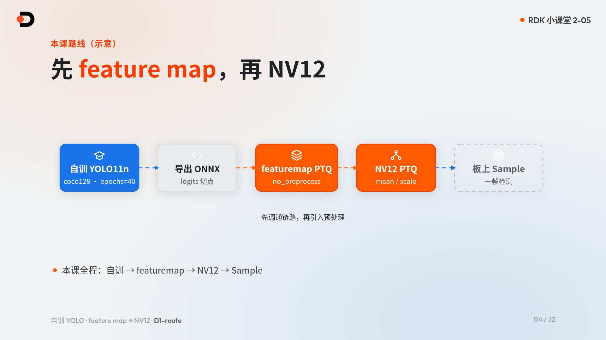
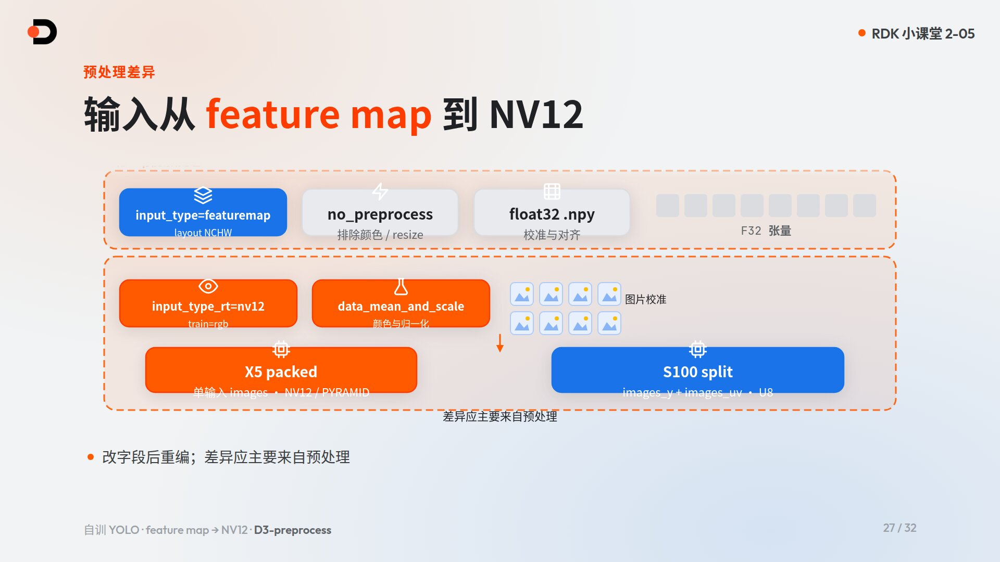
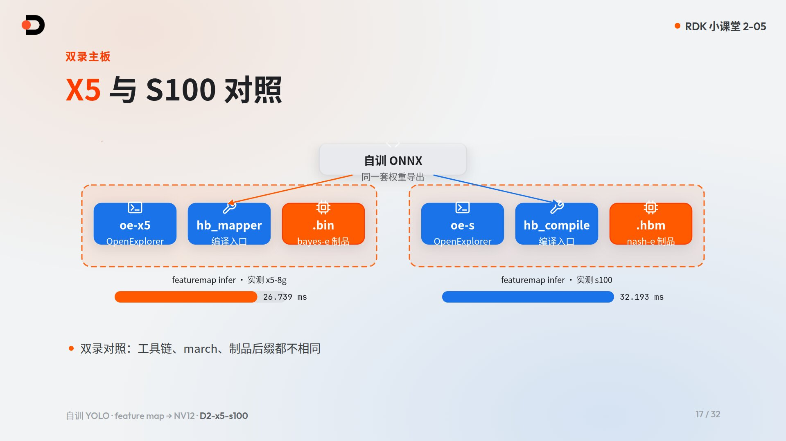
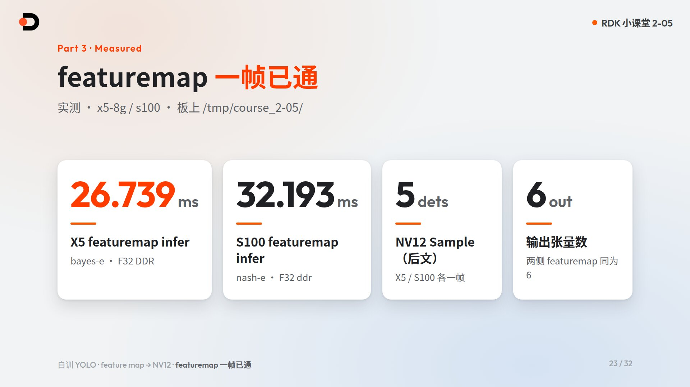
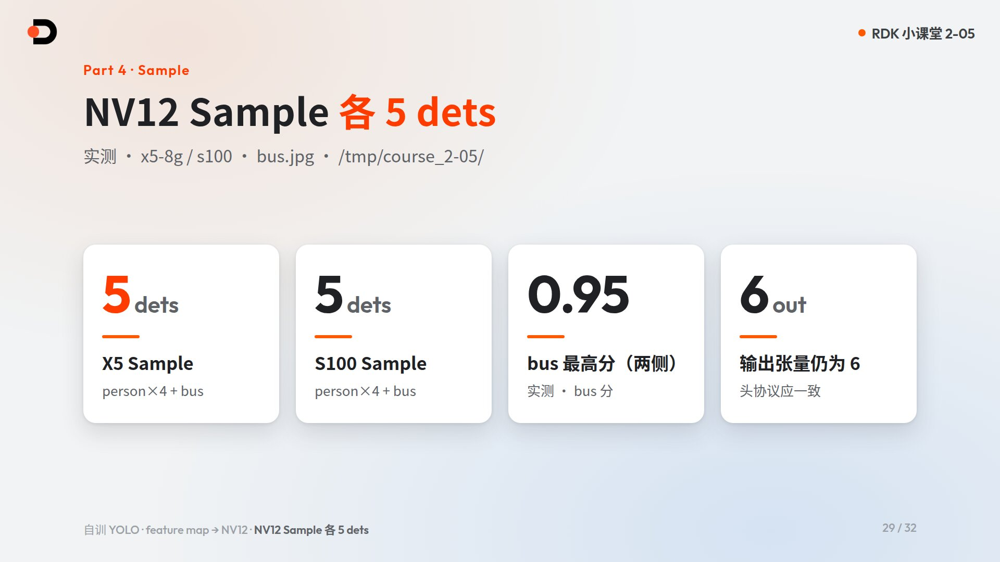

# Train YOLO: Feature Map First, Then NV12

> Course: RDK Classroom · Chapter 2 Model Zoo · Lesson 5
>
> Boards covered: RDK X5, RDK S100 (RDK Model Zoo `main` branch; this lesson dual-records `bayes-e` / `nash-e`)
>
> Course goal: Fine-tune YOLO11n on a public mini set; run OE PTQ with the “feature map first, then NV12” order; complete one full featuremap infer frame on both X5 and S100; run the NV12 artifacts once through the `ultralytics_yolo` Sample
>
> Learning format: concepts + PC train/export + OE (toolchain Docker) PTQ + on-board deploy/eval. Train on the host, not on the board. Board writes only under `/tmp/course_2-05/`
>
> Video: <!-- TODO: add Bilibili link after publish -->**To be published**
>
> Slides: [Open English HTML slides on GitHub](https://github.com/D-Robotics/rdk-course-demos/blob/develop/02_modelzoo/05_train-yolo-featuremap-nv12/lesson-2-05.html) · [中文课件源码](https://github.com/D-Robotics/rdk-course-demos/blob/develop/02_modelzoo/05_train-yolo-featuremap-nv12/lesson-2-05.zh.html)

---

## Companion resources

| Resource | Purpose |
|---|---|
| [RDK Model Zoo](https://github.com/D-Robotics/rdk_model_zoo) | Conversion recipes, board runtime, official reference artifacts |
| [`samples/vision/ultralytics_yolo/`](https://github.com/D-Robotics/rdk_model_zoo/tree/main/samples/vision/ultralytics_yolo) | Primary sample for this lesson |
| [RDK Resource Center](https://developer.d-robotics.cc/rdk_doc_center/en) | Official manuals |
| [RDK X5 Algorithm Toolchain Guide](https://developer.d-robotics.cc/rdk_doc/en/04_toolchain_development) | X5 toolchain entry; versions follow the docs |
| [RDK S Series Algorithm Toolchain Guide](https://developer.d-robotics.cc/rdk_doc/en/rdk_s/04_toolchain_development) | S-series toolchain entry; versions follow the docs |
| [S-series env install (CPU and GPU Docker)](https://developer.d-robotics.cc/oe_s_doc/guide/env_install) | Official images include CPU and GPU variants; PTQ can finish on CPU |
| [hrt_model_exec](https://developer.d-robotics.cc/oe_s_doc/guide/ucp/runtime/tool_introduction/hrt_model_exec) | On-board `model_info` / `infer` |
| Lesson measurements | Draft slide anchors; `board-tests/measured.json` is **not in this repo**, and this PR did not re-measure |

!!! note "Board numbers and the S100 combination are not verified by this PR"
    The **26.739 ms / 32.193 ms / 5 dets** figures below are draft slide anchors. This repo has no `board-tests/measured.json` and did not re-run X5 or S100. How the toolchain combines S100's on-disk /255 files with YAML `data_scale` is documented as pending in [conversion/README.md](https://github.com/D-Robotics/rdk-course-demos/blob/develop/02_modelzoo/05_train-yolo-featuremap-nv12/conversion/README.md).


---

## 1. What problem does this lesson solve?

Official NV12 Zoo artifacts are useful references. With **your own weights**, the usual blockers are export cut-points, whether failures come from the **graph/toolchain path** or from **pre-processing**, and how to take one ONNX through both X5 and S100.

This lesson’s spine: **train YOLO11n → feature map path first → then NV12 back into Sample**.



---

## 2. What you will be able to do

- Train YOLO11n on **coco128** (default `epochs=40`) and export ONNX at the 2-04 cut-point;
- Explain why **featuremap** (`no_preprocess` + float calibration) comes before **NV12**;
- Edit the YAML fields and `march` values (`bayes-e` / `nash-e`);
- Run the full OE flow twice (featuremap and NV12) for both boards;
- On board: `model_info` + **one full featuremap infer**, then one NV12 Sample frame under `/tmp/course_2-05/`;
- Cite the locked numbers: featuremap infer **26.739 ms** (X5) / **32.193 ms** (S100); NV12 Sample **5 dets** each on `bus.jpg`.

---

## 3. Why walk the full path on your own weights

| Item | Locked for this lesson |
|---|---|
| Model | YOLO11n detect |
| Data | coco128 |
| Where to train | PC / host (not on the board) |
| Epochs | 40 default (early stop OK) |
| Training footage | ~10× time-lapse + on-screen note |
| Sample | `ultralytics_yolo` |
| Wording | Always **NV12** (never NVR) |

---

## 4. Train and export (PC)

### 4.1 Train skeleton

```bash
yolo detect train data=coco128.yaml model=yolo11n.pt epochs=40 imgsz=640
```

### 4.2 Export cut-point (see lesson 2-04)

Stop the graph at multi-scale **cls + DFL logits**; keep post-process in runtime. Do not mix YOLO26 LTRB with DFL. Opset habits (often 11 on X5 / 19 on S) follow the conversion README.

### 4.3 Naming

| | X5 | S100 |
|---|---|---|
| `march` | `bayes-e` | `nash-e` |
| Suffix | `.bin` | `.hbm` |
| Short name habit | `…_bayese_…` | `…_nashe_…` |

Prefix: `selftrain_yolo11n_detect_`.

---

## 5. Two-step rule: feature map, then NV12



### 5.0 What OE `featuremap` means

In this lesson’s YAML, `input_type_*=featuremap` means the **float32 tensor fed straight into the network** (calibration tensors matching the ONNX input). It is **not** a CNN intermediate feature map. RGB layout and NV12 (Y + interleaved UV) are different **input protocols**—do not confuse dtype/layout with color format.

Docs:

- X5 OE quantize/compile: train_* = float model input domain; rt_* = edge runtime input; featuremap is a float32 tensor type.  
  https://developer.d-robotics.cc/oe_x5_doc/cn/oe_mapper/source/ptq/ptq_usage/quantize_compile.html
- S100 OE: rt/train combinatorics; featuremap=float32; nv12=UINT8; **train ≠ “run training”**—it is the training-time model input domain.  
  https://developer.d-robotics.cc/oe_s_doc/guide/ptq/ptq_tool/hb_compile/convert
- X5 `norm_type` formulas (`no_preprocess` / `data_mean` / `data_scale` / `data_mean_and_scale`):  
  https://developer.d-robotics.cc/oe_x5_doc/cn/oe_mapper/source/ptq/ptq_appendix/norm_type.html

### 5.1 Featuremap first

| Field | featuremap |
|---|---|
| `input_type_rt` / `input_type_train` | `featuremap` |
| `input_layout_*` | `NCHW` |
| `norm_type` | `no_preprocess` |
| calibration | float32 tensors (per board below) |

#### This lesson — FM side-by-side (real YAML)

| Item | X5 FM | S100 FM |
|---|---|---|
| File | `ptq_featuremap_x5.yaml` | `ptq_featuremap_s100.yaml` |
| march | `bayes-e` | `nash-e` |
| rt / train | featuremap / featuremap | featuremap / featuremap |
| norm | `no_preprocess` | `no_preprocess` |
| cal_dir | `cal_featuremap_x5_rgbchw` | `cal_featuremap_s100_npy` |
| Measured cal range | float32 **0..255** (`.rgbchw`) | float32 **/255 → 0..1** (`.npy`) |

When comparing ONNX Runtime vs the quantized model on host, use **that board’s own calibration tensors** and toolchain (per `conversion/*.yaml` + cal dirs). X5 and S100 differ in file shape and numeric range—**do not mix**, and do not say “one shared npy”.

Hard requirement on board: **one full infer frame**, not `model_info` alone.

The X5 featuremap value 0..255 is the on-disk file under `no_preprocess`. The upstream NV12 recipe's "X5 is not divided by 255" also carries YAML `data_scale`, so it does not prove this featuremap file already matches the float ONNX. This cell is pending the same OE check as the S100 NV12 combination; see [conversion/README.md](https://github.com/D-Robotics/rdk-course-demos/blob/develop/02_modelzoo/05_train-yolo-featuremap-nv12/conversion/README.md).


### 5.2 Then NV12

This lesson matches Model Zoo `ultralytics_yolo/conversion/config_x5.yaml`: NV12 uses **`norm_type: data_scale`** with `scale_value ≈ 0.003921568627451` (**1/255**), **not** `data_mean_and_scale`. We only need ×1/255; a mean term is unused and would disagree with the real configs.

| Field | NV12 (this lesson) |
|---|---|
| `input_type_rt` | `nv12` |
| `input_type_train` | `rgb` (training-time input domain—not “train again”) |
| `norm_type` | **`data_scale`** |
| `scale_value` | `0.003921568627451` (≈1/255) |

#### This lesson — NV12 side-by-side (real YAML)

| Item | X5 NV12 | S100 NV12 |
|---|---|---|
| File | `ptq_nv12_x5.yaml` | `ptq_nv12_s100.yaml` |
| rt / train | nv12 / rgb | nv12 / rgb |
| norm / scale | `data_scale` / ≈1/255 | same |
| cal_dir | `cal_nv12_rgb_f32` | `cal_nv12_s100_npy` |
| Measured cal range (on disk) | float32 **0..255** `.rgbchw` (YAML **also lists** `data_scale`≈1/255, matching Zoo `config_x5` fields—**do not** assert OE internal multiply here) | float32 **/255 → 0..1** `.npy` (same on-disk status as S100 FM; YAML **also lists** the same fields. **How OE/S consumes “already /255 files + data_scale” is pending upstream—this lesson does not claim a proven /255-then-×scale loop**) |

X5: packed NV12. S100: `images_y` + `images_uv`. **Do not claim both boards share one cal numeric range**—write them per board.

### 5.3 Closed loop: prepare → range → calibrate → runtime

| Path | Prepare | Tensor range | YAML norm | Runtime (rt) |
|---|---|---|---|---|
| X5 FM | `prepare_cal_data.py` → `.rgbchw` | 0..255 | `no_preprocess` | featuremap float32 |
| S100 FM | same → `.npy` (/255) | 0..1 | `no_preprocess` | featuremap float32 |
| X5 NV12 | same → `cal_nv12_rgb_f32` | 0..255 | YAML lists `data_scale`≈1/255 (field status; matches Zoo) | nv12 UINT8 packed |
| S100 NV12 | same → `cal_nv12_s100_npy` (/255) | 0..1 | YAML lists `data_scale`≈1/255 (field status; **combo with on-disk /255 pending upstream**—not a proven closed loop here) | nv12 UINT8 Y+UV |

Differences after the switch should come mainly from pre-processing; output head count stays 6 in this lesson.

---

## 6. OE hands-on: full PTQ flow



Open OE → check env → export ONNX → YAML + compile (full logs) → artifacts → board → eval. Repeat for featuremap and NV12 on both boards.

| | X5 | S100 |
|---|---|---|
| Launcher | `oe-x5` | `oe-s` |
| Compiler | `hb_mapper` | `hb_compile` |
| `march` | `bayes-e` | `nash-e` |
| Artifact | `.bin` | `.hbm` |

### CPU / GPU

PTQ can finish on a **CPU** Docker image; GPU is optional acceleration. Official docs provide both CPU and GPU images for X5 and the S series. Do not imply S100 requires GPU. Log into the registry with your own account; never paste passwords into notes.

Compare against `ultralytics_yolo/conversion/` read-only (§5.2).

---

## 7. On-board labs

Board writes **only** `/tmp/course_2-05/`.

### Artifacts

| | X5 | S100 |
|---|---|---|
| featuremap | `selftrain_yolo11n_detect_bayese_640x640_featuremap.bin` | `selftrain_yolo11n_detect_nashe_640x640_featuremap.hbm` |
| NV12 | `selftrain_yolo11n_detect_bayese_640x640_nv12.bin` | `selftrain_yolo11n_detect_nashe_640x640_nv12.hbm` |

### Featuremap infer anchors

Draft anchors only. The draft names `board-tests/measured.json` (boards `x5-8g` / `s100`); that file is not in this repo, and the milliseconds below were not re-measured for this PR.



| Board | featuremap infer |
|---|---|
| X5 | **26.739 ms** |
| S100 | **32.193 ms** |

### NV12 Sample



Both boards: **5 dets** on `bus.jpg` (4× person + bus). See appendix for commands.

---

## 8. Rules for newcomers

1. Featuremap first, then NV12.
2. Only write `/tmp/course_2-05/` on the board.
3. One full featuremap infer is mandatory.
4. Respect `march` / suffix; do not mix boards.
5. Always say **NV12**; toolchain versions follow official docs.
6. CPU Docker is enough for PTQ.
7. No passwords or intranet endpoints in notes.

---

## 9. FAQ

### Q1: Why not jump straight to NV12?

Debugging is harder. Featuremap separates graph/toolchain issues from color/resize/mean issues.

### Q2: Good featuremap cosine, poor NV12 Sample?

Check pre-process YAML, calibration images, and packed vs Y+UV. If output heads changed, revisit the 2-04 export cut-point.

### Q3: Does S100 require GPU Docker?

No. PTQ can complete on CPU images.

### Q4: Can an X5 `.bin` run on S100?

No.

### Q5: Must training use 40 epochs?

Default 40; early stop is fine.

### Q6: Why not write under the home directory on the board?

Course rule: temporary per-lesson directory only.

---

## Lesson recap

Train → featuremap (26.739 / 32.193 ms) → NV12 (5 dets each). Next: **Lesson 2-06 Inference APIs**.

---

## Completion checklist

- [ ] Export ONNX at the 2-04 cut-point
- [ ] Featuremap YAML + one full on-board infer
- [ ] NV12 rebuild + Sample one frame on both boards
- [ ] All board outputs under `/tmp/course_2-05/`
- [ ] Can explain “featuremap then NV12”

---

## Further practice

1. Rebuild NV12 with domain calibration images and compare Sample scores.
2. Keep a host-side ONNX↔quant cosine table on a fixed **per-board** cal tensor (X5 `.rgbchw` / S100 `.npy`; do not mix).
3. Diff your YAML against the official conversion recipes.

---

## Appendix: command cheat sheet

```bash
yolo detect train data=coco128.yaml model=yolo11n.pt epochs=40 imgsz=640

mkdir -p /tmp/course_2-05
hrt_model_exec model_info --model_file /tmp/course_2-05/<fm>
hrt_model_exec infer --model_file /tmp/course_2-05/<fm> \
  --input_file /tmp/course_2-05/<input> --enable_dump true --frame_count 1

python3 samples/vision/ultralytics_yolo/runtime/python/main.py \
  --task detect --platform x5 --family yolo11 \
  --model-path /tmp/course_2-05/selftrain_yolo11n_detect_bayese_640x640_nv12.bin \
  --test-img samples/vision/ultralytics_yolo/test_data/bus.jpg \
  --label-file samples/vision/ultralytics_yolo/test_data/coco_classes.names \
  --img-save-path /tmp/course_2-05/selftrain-x5-nv12.jpg

python3 samples/vision/ultralytics_yolo/runtime/python/main.py \
  --task detect --platform s100 --family yolo11 \
  --model-path /tmp/course_2-05/selftrain_yolo11n_detect_nashe_640x640_nv12.hbm \
  --test-img samples/vision/ultralytics_yolo/test_data/bus.jpg \
  --label-file samples/vision/ultralytics_yolo/test_data/coco_classes.names \
  --img-save-path /tmp/course_2-05/selftrain-s100-nv12.jpg
```

Toolchain versions and image tags follow official documentation.
