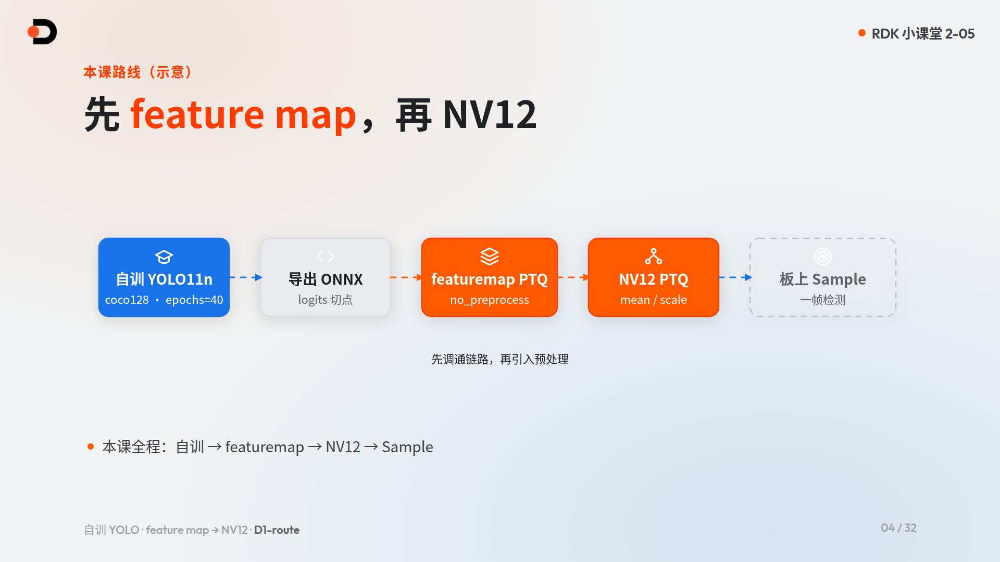
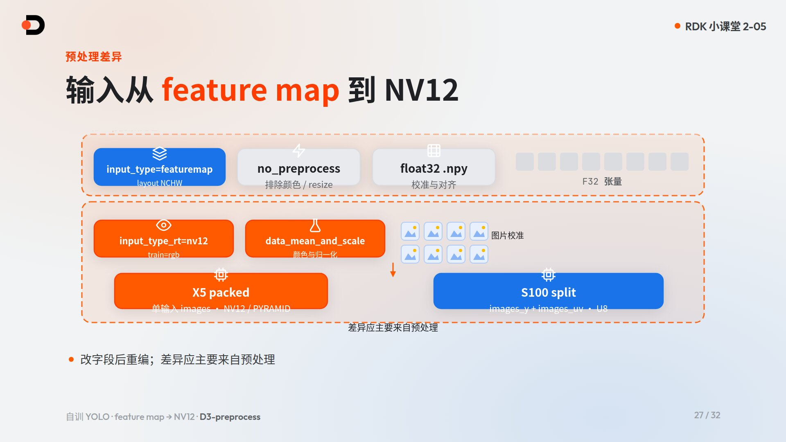
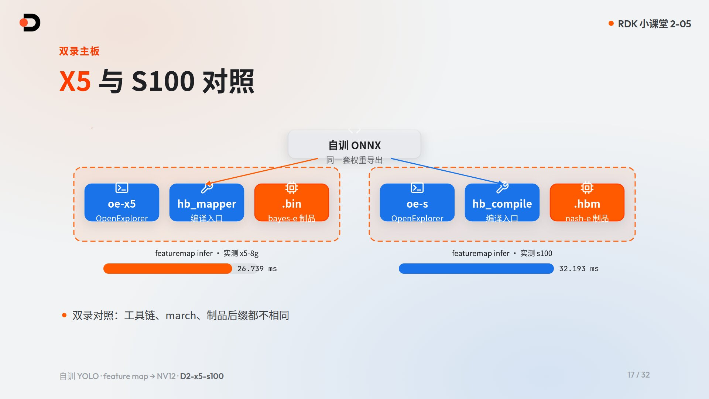
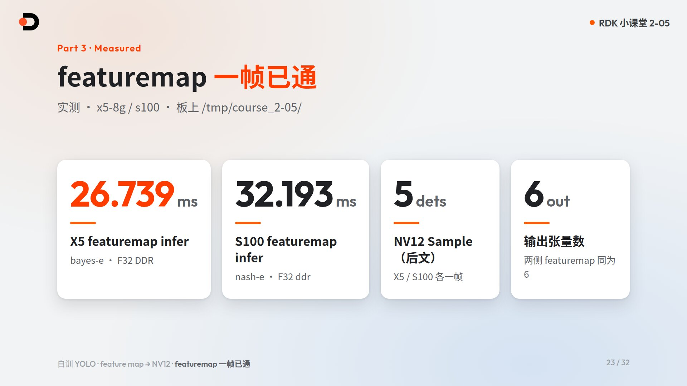
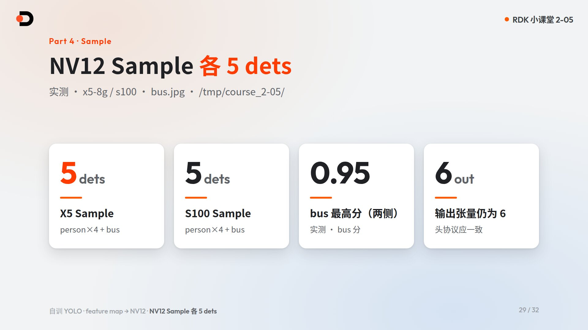

# 自训 YOLO：feature map 调通再改 NV12

> 所属章节：RDK 小课堂 · 第 2 章 Model Zoo · 第 5 课
>
> 适用板卡：RDK X5、RDK S100（RDK Model Zoo `main` 分支；本课双录 `bayes-e` / `nash-e`）
>
> 课程目标：在公开小数据集上用 YOLO11n 自训一条检测；按「先 feature map、再 NV12」完成 OE 量化与上板；在 X5 与 S100 上各自跑通 featuremap 一帧完整 infer，并把 NV12 制品放回 `ultralytics_yolo` Sample 跑通一帧
>
> 学习方式：概念讲解 + PC 侧自训/导出 + OE（工具链 Docker）量化实操 + 板端部署与评估。训练在开发机完成，板端不装训练框架；板上只写 `/tmp/course_2-05/`
>
> 配套视频：[B 站观看「自训 YOLO：feature map 调通再改 NV12」](https://www.bilibili.com/video/BV1WkWW6NEbo/)
>
> 配套课件：[查看中文 HTML 课件源码](https://github.com/D-Robotics/rdk-course-demos/blob/develop/02_modelzoo/05_train-yolo-featuremap-nv12/lesson-2-05.zh.html) · [English slide source](https://github.com/D-Robotics/rdk-course-demos/blob/develop/02_modelzoo/05_train-yolo-featuremap-nv12/lesson-2-05.html)

---

## 配套资源

| 资源 | 用途 |
|---|---|
| [RDK Model Zoo](https://github.com/D-Robotics/rdk_model_zoo) | 转换配方、板端 runtime、官方对照制品 |
| [`samples/vision/ultralytics_yolo/`](https://github.com/D-Robotics/rdk_model_zoo/tree/main/samples/vision/ultralytics_yolo) | 本课主 Sample：conversion / runtime / `test_data/bus.jpg` |
| [RDK 文档资源中心](https://developer.d-robotics.cc/rdk_doc_center/) | 各板卡官方手册入口 |
| [RDK X5 算法工具链开发指南](https://developer.d-robotics.cc/rdk_doc/04_toolchain_development) | X5 工具链入口；版本与环境**以工具链文档为准** |
| [RDK S 系列算法工具链开发指南](https://developer.d-robotics.cc/rdk_doc/rdk_s/04_toolchain_development) | S100 / S100P / S600 工具链入口；版本与环境**以工具链文档为准** |
| [X5 环境安装 / OE Docker](https://developer.d-robotics.cc/oe_x5_doc/cn/oe_mapper/source/env_install.html) | X5 OE 容器与 PTQ 环境 |
| [S 系列环境部署（含 CPU / GPU Docker）](https://developer.d-robotics.cc/oe_s_doc/guide/env_install) | S 系列提供 CPU 与 GPU 两套 Docker，可按需选择；PTQ 用 CPU 镜像即可完整做完 |
| [hrt_model_exec 工具介绍](https://developer.d-robotics.cc/oe_s_doc/guide/ucp/runtime/tool_introduction/hrt_model_exec) | 板端 `model_info` / `infer` |
| 本课板测汇总 | 课内 `board-tests/measured.json`（featuremap infer、NV12 Sample） |

---

## 1. 本课要解决什么问题

官方 Model Zoo 里已经有不少「开箱即用」的 YOLO NV12 制品。可是当你换成**自己训出来的权重**时，常见卡点不是「会不会训」，而是：

1. **导出切点**是否还和 2-04 / Sample runtime 的后处理协议一致？
2. 量化失败或精度掉很多时，问题出在**链路**还是出在**预处理（颜色、resize、mean/scale）**？
3. X5 与 S100 工具链、`march`、制品后缀不同，怎样**同一套自训 ONNX**分别走通？

本课用一条贯穿线回答：**自训 YOLO11n → 先 feature map 调通 → 再改 NV12 回 Sample**。



---

## 2. 完成本课后你能做到什么

- 在 **coco128** 公开迷你集上，用 **YOLO11n** 跑通一次检测训练（默认 `epochs=40`，可早停），并按 2-04 切点导出 ONNX；
- 说清为什么要先做 **featuremap**（`no_preprocess` + float32 校准），再改 **NV12**；
- 对照改 YAML 关键字段：`input_type_*`、`norm_type`、校准数据格式，以及 X5 `bayes-e` / S100 `nash-e`；
- 在 OE 里按量化课完整流程走完（打开 OE → 配环境 → 导出 → YAML+编译 → 产物 → 上板 → 评估），featuremap 与 NV12 **各走一遍**；
- 在板上 `/tmp/course_2-05/` 完成：`model_info` + **一帧完整 infer**（featuremap），以及 Sample **跑通一帧**（NV12）；
- 读懂本课两次 X5 读数：成片实拍 Infer 是 **26.663 ms**（单独一次运行）。**25.772 ms** 和 **8 dets** 来自另一次日志与后处理；旁白里的 25.772 只配那份日志，不是 26.663 那一次。26.685 ms 是实验记录，不是成片镜。S100 板上 Infer **33.145 ms**；**7 dets** 是主机对板上 dump 的离板后处理，不是板上 decode。NV12 Sample 各 **5 dets** 不是 featuremap。

---

## 3. 为何要用自己的权重走完整链路

官方 `*_nv12` 制品适合对照，但「说服力」来自：**同一条自训权重**从训练、导出、量化到上板全部跑通。

本课默认约定：

| 项 | 本课锁定 |
|---|---|
| 模型 | YOLO11n detect |
| 数据 | coco128（Ultralytics 公开迷你集） |
| 训练位置 | PC / 开发机；**板端不装训练框架** |
| 训练轮数 | 默认 `epochs=40`（可早停） |
| 训练镜头 | 约 **10×** 缩时录制 + 角标「训练已加速，未展全程」 |
| Sample 对齐 | `ultralytics_yolo` conversion / runtime |
| 文案 | 一律写 **NV12**（不要写成 NVR） |

公开小集只用于演示链路，不是业务数据；不要求追榜 mAP。

---

## 4. 自训与导出（PC）

### 4.1 训练命令骨架

在开发机（非板端）执行，超参可按机器调整；成片里的关键数字来自板测，不来自训练 loss。

```bash
# PC / 开发机
yolo detect train data=coco128.yaml model=yolo11n.pt epochs=40 imgsz=640
# 产物通常在 runs/.../weights/best.pt
```

### 4.2 导出切点回指 2-04

导出要对齐 `ultralytics_yolo/conversion`：**图停在多尺度 cls + DFL logits**，后处理留在 runtime。细节已在 2-04 讲过，本课不重讲。

注意：

- **YOLO26 LTRB** 与 DFL 协议不可混用；
- opset 常见习惯值：X5 侧常 **11**、S 侧常 **19**，**以 conversion README / 工具链文档为准**；
- 导出产物放入 OE 可访问的共享工作目录后再编译。本课主线编译用的是冻结 ONNX `e6a57789…`。另一次导出的文件前缀是 `a9e88f08`，图和 ORT 与冻结件一致，但文件不同，不能写成编译输入。

### 4.3 命名与制品后缀

| | X5 | S100 |
|---|---|---|
| `march` | `bayes-e` | `nash-e` |
| 制品后缀 | `.bin` | `.hbm` |
| 短名习惯 | `…_bayese_…` | `…_nashe_…` |

自训前缀建议使用 `selftrain_yolo11n_detect_`，避免和官方 `*_nv12` 混淆。完整短名示例见第 7 节。

---

## 5. 两步原则：先 feature map，再 NV12

量化失败或精度异常时，先问：**链路通不通**，再问：**预处理对不对**。



### 5.0 OE「featuremap」口径（防误解）

本课 YAML 里的 `input_type_*=featuremap` 表示：**直接喂给网络的 float32 输入张量**（与 ONNX 输入一致的校准张量）。  
它**不是** CNN 中间层 feature map。  
RGB 通道排布与 NV12（Y + 交错 UV）是不同**输入协议**；dtype/layout 不要和颜色格式混为一谈。

官方对照：

- X5 OE：`input_type_train` + `input_layout_train` = 原始浮点模型输入域；`input_type_rt` + `input_layout_rt` = 边缘侧对接输入。featuremap 中间类型为 float32 张量。  
  https://developer.d-robotics.cc/oe_x5_doc/cn/oe_mapper/source/ptq/ptq_usage/quantize_compile.html
- S100 OE：rt/train 组合表；featuremap=float32；nv12=UINT8；**train ≠「执行训练」**——是训练时模型输入域。  
  https://developer.d-robotics.cc/oe_s_doc/guide/ptq/ptq_tool/hb_compile/convert
- X5 `norm_type` 定义（`no_preprocess` / `data_mean` / `data_scale` / `data_mean_and_scale`）：  
  https://developer.d-robotics.cc/oe_x5_doc/cn/oe_mapper/source/ptq/ptq_appendix/norm_type.html

### 5.1 第一步 · featuremap（排除预处理变量）

目的：先跑通 **ONNX → 量化 → 板端**，与颜色空间、resize、mean/scale 对齐无关。

典型字段（本课 `conversion/ptq_featuremap_{x5,s100}.yaml`）：

| 字段 | featuremap |
|---|---|
| `input_type_rt` / `input_type_train` | `featuremap` |
| `input_layout_*` | `NCHW` |
| `norm_type` | `no_preprocess` |
| 校准 | float32 张量（见下表分板） |

#### 本课 FM 并排（实配）

| 项 | X5 FM | S100 FM |
|---|---|---|
| 文件 | `ptq_featuremap_x5.yaml` | `ptq_featuremap_s100.yaml` |
| march | `bayes-e` | `nash-e` |
| rt / train | featuremap / featuremap | featuremap / featuremap |
| layout | NCHW / NCHW | NCHW / NCHW |
| norm | `no_preprocess` | `no_preprocess` |
| cal_dir | `cal_featuremap_x5_rgbchw` | `cal_featuremap_s100_npy` |
| 校准数值域 | float32 **0..1**（像素÷255 → raw `.rgbchw` tofile） | float32 **0..1**（`/255` → `.npy`） |
| 容器 | `.rgbchw` | `.npy` |

自训 ONNX 期望输入域 **0..1**（Ultralytics 训练外部 ÷255；ONNX 图中无 Div）。两板 FM 数值域相同，**仅容器不同**——对照时用该板自己的校准文件与工具链，**不能混用**，也不要说「同一份 npy」。  
YAML 两板均为 `norm_type: no_preprocess`。板端硬要求：**一帧完整 infer**，只跑 `model_info` 不算过关。  
**边界**：本节与 PR19 板测是**单图输入域闭环**验证，**不是** mAP 或泛化精度认证，禁止写成「全精度验证」。

### 5.2 第二步 · NV12（引入预处理）

在 featuremap 已通的前提下，再改输入与校准，让制品贴近摄像头 / Sample 管线。

本课与 Model Zoo `ultralytics_yolo/conversion/config_x5.yaml` 一致：NV12 使用 **`norm_type: data_scale`**，`scale_value ≈ 0.003921568627451`（**1/255**），**不是** `data_mean_and_scale`。  
原因：本课/Zoo 校准与训练输入域按「仅 ×1/255」对齐，无额外 mean 偏移；选 `data_mean_and_scale` 会引入未使用的 mean 项，与实配不符。

| 字段 | NV12（本课实配） |
|---|---|
| `input_type_rt` | `nv12`（运行时相机/Sample 侧） |
| `input_type_train` | `rgb`（网络训练时输入域；**不是**「再训一遍」） |
| `norm_type` | **`data_scale`** |
| `scale_value` | `0.003921568627451`（≈1/255） |
| 校准 | 分板（见下表） |

#### 本课 NV12 并排（实配）

| 项 | X5 NV12 | S100 NV12 |
|---|---|---|
| 文件 | `ptq_nv12_x5.yaml` | `ptq_nv12_s100.yaml` |
| march | `bayes-e` | `nash-e` |
| rt / train | nv12 / rgb | nv12 / rgb |
| layout train | NCHW | NCHW（另含 shape `1x3x640x640`） |
| norm / scale | `data_scale` / ≈1/255 | 同左 |
| cal_dir | `cal_nv12_rgb_f32` | `cal_nv12_s100_npy` |
| 校准（磁盘） | float32 **0..255** `.rgbchw` | float32 **/255 → 0..1** `.npy` |
| 工具链消费（已证） | mapper **HzPreprocess**（YAML `data_scale`≈1/255） | 编译**先 calibrate（见 0..1）→ 再 quantize 时 `insert_image_preprocess`**；YAML `data_scale` 用于 **runtime**，**不是**校准二次 `/255` |

协议差异：

- **X5**：packed 单输入 NV12；
- **S100**：拆成 `images_y` + `images_uv` 双输入。

**不能**用旧「X5 FM=0..255」口径类比 NV12 或当前 FM；FM 与 NV12 是两套合同。

### 5.3 闭环：数据准备 → 数值范围 → 校准 → 运行输入

| 路径 | 数据准备 | 张量范围 | YAML 归一化 | 运行输入（rt） |
|---|---|---|---|---|
| X5 FM | `prepare_cal_data.py` → `.rgbchw`（值÷255） | **0..1** | `no_preprocess` | featuremap float32 |
| S100 FM | 同脚本 → `.npy`（/255） | **0..1** | `no_preprocess` | featuremap float32 |
| X5 NV12 | 同脚本 → `cal_nv12_rgb_f32` `.rgbchw` | **0..255** | `data_scale`≈1/255 → mapper **HzPreprocess** | nv12 UINT8（packed） |
| S100 NV12 | 同脚本 → `cal_nv12_s100_npy` `.npy`（/255） | **0..1** | calibrate 见 0..1；quantize 插预处理；`data_scale` 给 **runtime**（非二次 /255） | nv12 UINT8（Y+UV） |

改字段后重新编译；**差异应主要来自预处理**。输出头协议（本课两侧均为 6 个输出张量）应保持一致。

---

## 6. OE 实操：量化全流程一步不跳

量化课要把完整流程按顺序展示（手册 §5.1）。本课对 **featuremap** 与 **NV12** 各走一遍，并在 **X5 + S100** 双录。



### 6.1 画面上要有的步骤

1. **打开 OE**：用课程提供的 `oe-x5` / `oe-s` 入口进入容器（具体启动方式以本机 OE 说明与工具链文档为准）；
2. **配环境**：查看工具版本；版本号统一写「**以工具链文档为准**」；
3. **导出 ONNX**：脚本、命令与生成的 `.onnx`；
4. **写 YAML + 编译/量化**：日志完整、正常速度；改 `onnx_model`、shape、`march`、校准目录；
5. **产物**：X5 `.bin` / S100 `.hbm`；
6. **上板部署**：拷到 `/tmp/course_2-05/`；
7. **评估**：Host 对照 + 板端 `model_info` + **完整一帧 infer** / Sample 一帧。

纯等待段落若加速录制，需加角标说明；编译日志本身不要跳。

### 6.2 工具链入口对照

| | X5 | S100 |
|---|---|---|
| 入口 | `oe-x5` | `oe-s` |
| 编译工具 | `hb_mapper` | `hb_compile` |
| `march` | `bayes-e` | `nash-e` |
| 产物 | `.bin` | `.hbm` |

### 6.3 CPU / GPU 说明（必读）

- **PTQ 量化用 CPU Docker 就能完整做完**；GPU 只是可选加速。
- 官方对 X5 与 S 系列都提供 **CPU 与 GPU** 两套 Docker 镜像（见工具链「环境安装 / 环境部署」页）。S 系列文档写明可按需选择，CPU 镜像通过相应参数启动。
- **不要以为 S100 必须上 GPU 才能做本课 PTQ**；某一环境若启用了 GPU，也请记住「用 CPU 也可以」。
- 「板上算子落在 CPU」与开发机 Docker 用不用 GPU 是两件事，不要混谈。
- 拉取镜像时用**自己的账号**登录官方 Registry；**不要把口令写进讲义或脚本。**

### 6.4 对照 Model Zoo conversion（§5.2）

打开 `ultralytics_yolo/conversion/`，对照本课 YAML：featuremap 字段、自训 onnx 路径、校准目录、`march`。只读对照，**不要改 Model Zoo 仓库源码**。

---

## 7. 上板实操

板端 SSH 别名以本机环境为准（常见：`x5-8g`、`s100`）。**板上只写 `/tmp/course_2-05/`**，不装软件、不改配置、不重启。

### 7.1 自训制品短名（本课）

| | X5 | S100 |
|---|---|---|
| featuremap | `selftrain_yolo11n_detect_bayese_640x640_featuremap.bin` | `selftrain_yolo11n_detect_nashe_640x640_featuremap.hbm` |
| NV12 | `selftrain_yolo11n_detect_bayese_640x640_nv12.bin` | `selftrain_yolo11n_detect_nashe_640x640_nv12.hbm` |

### 7.2 featuremap：`model_info` + 一帧完整 infer

```bash
mkdir -p /tmp/course_2-05
# 主机侧把自训制品与一帧输入拷到该目录后：

hrt_model_exec model_info --model_file /tmp/course_2-05/<featuremap制品>

# 硬要求：再跑一帧完整 infer（输入文件名以板测准备为准）
hrt_model_exec infer \
  --model_file /tmp/course_2-05/<featuremap制品> \
  --input_file /tmp/course_2-05/<一帧输入> \
  --enable_dump true \
  --frame_count 1
```

本课实测 `model_info`（featuremap）要点：

| | X5 | S100 |
|---|---|---|
| 输入名 | `images` | `images` |
| 形状 | `[1,3,640,640]` | `[1,3,640,640]` |
| dtype / 来源 | F32 · DDR | F32 · ddr |
| 输出张量数 | 6 | 6 |

### 7.3 本课锁定的 featuremap 时延 / 域闭环（NEW）

**当前主镜（2026-11-06 · 只喂 0..1）**

| 项 | 主线 |
|---|---|
| 冻结编译 ONNX | `e6a57789f03b27c35701226ac7eee84ae530f1a88b2e2eb34dbaf7acb24fe1a0` |
| 另一次导出 | 前缀 `a9e88f08`。图和 ORT 与冻结件一致，文件不同，**不是**编译输入 |
| X5 FM bin | `f728b1d3113953cc43c93226657e99712d01fcfb83fce6f3f2dc69b39c2852fb` |
| X5 成片实拍 Infer | **26.663 ms**。单独一次运行，不要写成 25.772 |
| X5 日志与后处理 | **25.772 ms**，同图 decode **8 dets**。旁白 25.772 只配这次日志，不是 26.663 那一次 |
| X5 实验记录 | **26.685 ms**。同一份 bin 的实验读数，不是成片镜 |
| 六头 vs ORT(/255) cosine | 全部 **≥0.991** |
| X5 后处理 | Zoo `decode_dfl`，score=**0.25** / nms=**0.45**；与 ORT 同为 **8**；`{45:3, 50:1, 49:4}`。这组检测数属于 25.772 那次日志 |
| S100 FM | hbm 前缀 `35758dce`；板上 Infer **33.145 ms**。**7 dets** 是主机离板后处理，不是板上 decode。不要改成 8 |

**边界**：以上是**单图输入域闭环**，**不是** mAP 或泛化精度认证。

**历史（不得冒充主镜）**：31.316 ms 对应 bin `aee69bc1…`；26.739 ms 是更早的 0..255 校准；S100 32.193 ms 是更早读数。NV12 Sample 的 5 dets 不是 featuremap。



### 7.4 NV12：回到 Sample 跑通一帧

先对 NV12 制品做 `model_info`，确认输入已变为 NV12 协议、输出头仍为 6 路；再用 Sample：

```bash
# X5 示例
python3 samples/vision/ultralytics_yolo/runtime/python/main.py \
  --task detect --platform x5 --family yolo11 \
  --model-path /tmp/course_2-05/selftrain_yolo11n_detect_bayese_640x640_nv12.bin \
  --test-img samples/vision/ultralytics_yolo/test_data/bus.jpg \
  --label-file samples/vision/ultralytics_yolo/test_data/coco_classes.names \
  --img-save-path /tmp/course_2-05/selftrain-x5-nv12.jpg

# S100：把 --platform 换成 s100，模型换成 *_nashe_*_nv12.hbm，
# 出图可写 selftrain-s100-nv12.jpg
```

路径以你板上 Model Zoo 实际检出目录为准；参数名以 Sample README 为准。

### 7.5 NV12 Sample 实测结果

测试图：`bus.jpg`。两侧各检出 **5** 个目标（person×4 + bus）。分数以 `measured.json` 为准，例如两侧 bus 最高分约 **0.95**。



| | X5 NV12 `model_info` 要点 | S100 NV12 `model_info` 要点 |
|---|---|---|
| 输入 | `images` · NV12 · PYRAMID | `images_y` + `images_uv`（U8） |
| 输出张量 | 6 | 6 |
| Sample | 5 dets | 5 dets |

---

## 8. 新手规则

1. **先 featuremap 通，再改 NV12**；不要一上来就同时改输入格式和一堆超参。
2. **板上只写 `/tmp/course_2-05/`**；不装包、不改系统、不重启。
3. featuremap **必须**完整一帧 infer；只看 `model_info` 过不了本课。
4. 记住自己板的 `march` 与后缀：X5 `bayes-e` → `.bin`；S100 `nash-e` → `.hbm`；**不能混用**。
5. 文案与文件名一律 **NV12**；工具链版本与镜像标签**以官方文档为准**。
6. PTQ **可用 CPU 镜像做完**；不要把 GPU 写成 S 系列硬性前置。
7. 不向讲义、脚本、截图里写入账号口令或内网地址。

---

## 9. 常见问题

### Q1：为什么不直接训完就导出 NV12 制品？

可以，但排错成本高。先 featuremap 能把「图是否切对、量化是否通、板上能否跑」与「颜色/resize/mean 是否对齐」拆开。

### Q2：featuremap 余弦很高，NV12 Sample 却很差？

优先查预处理与校准：`input_type_*`、`norm_type`（本课 NV12 为 `data_scale`≈1/255）、校准图/张量范围是否代表真实输入分布，以及 X5 packed / S100 Y+UV 是否按板别配置。输出头协议若变了，要回查导出切点（2-04）。

### Q3：S100 必须用 GPU Docker 吗？

**不必。** PTQ 用 CPU Docker 即可完整做完；官方同时提供 CPU / GPU 镜像。GPU 仅加速可选。

### Q4：X5 的 `.bin` 能在 S100 上跑吗？

不能。`march` 与制品格式绑定；也不要把 `.hbm` 改后缀冒充 `.bin`。

### Q5：训练一定要 40 epoch 吗？

默认 40，可早停。本课目标是拿到可导出、可上板的权重，不是刷榜。

### Q6：板上路径为什么不能写到家目录？

课程规范：板测只使用课号临时目录，避免污染板端环境，也方便课后清理。

---

## 本课小结

- **自训**：YOLO11n + coco128 + 缩时角标，导出切点对齐 2-04；
- **featuremap**：两板数值域 **0..1**。成片实拍 X5 **26.663 ms**；25.772 ms 与 8 dets 是另一次日志。S100 板上 **33.145 ms**，7 dets 为离板后处理。单图，非 mAP。31.316 ms 与 aee 是历史；
- **NV12**：X5 磁盘 0..255 + HzPreprocess；S100 /255 + runtime `data_scale`（非二次 /255）；Sample 各 **5 dets**（旧 NV12，非 FM）；
- 下一课预告：**2-06《推理接口》**——Python / C++ 如何加载模型与读结果。

---

## 完成检查

- [ ] PC 上得到可导出的 YOLO11n 权重，并按 2-04 切点导出 ONNX
- [ ] featuremap YAML：`no_preprocess` + float 校准；X5 / S100 `march` 正确
- [ ] OE 编译日志完整；得到自训 featuremap 制品并完成板端一帧 infer
- [ ] NV12 YAML：`rt=nv12` / `train=rgb` / `data_scale`≈1/255 与分板校准已改；重编后 Sample `bus.jpg` 跑通一帧
- [ ] 产物与出图均在 `/tmp/course_2-05/`；未改 Model Zoo 源码
- [ ] 能向别人讲清「先 featuremap 再 NV12」的原因

---

## 拓展练习

1. 换一张接近你业务场景的校准图集，只重做 NV12 一轮，对比 Sample 分数变化；
2. 在 Host 侧按板固定校准张量（X5 `.rgbchw` / S100 `.npy`，勿混用），记录 ONNX ↔ 量化余弦，整理一页自己的对照表；
3. 阅读 `ultralytics_yolo/conversion/` 官方 YAML，列出本课自训 YAML 与官方的差异清单。

---

## 附录：命令速查

```bash
# —— PC：训练（骨架）——
yolo detect train data=coco128.yaml model=yolo11n.pt epochs=40 imgsz=640

# —— 板上：目录 ——
mkdir -p /tmp/course_2-05

# —— 板上：featuremap model_info ——
hrt_model_exec model_info --model_file /tmp/course_2-05/<fm>

# —— 板上：featuremap 一帧 infer ——
hrt_model_exec infer \
  --model_file /tmp/course_2-05/<fm> \
  --input_file /tmp/course_2-05/<input> \
  --enable_dump true --frame_count 1

# —— 板上：NV12 Sample（X5）——
python3 samples/vision/ultralytics_yolo/runtime/python/main.py \
  --task detect --platform x5 --family yolo11 \
  --model-path /tmp/course_2-05/selftrain_yolo11n_detect_bayese_640x640_nv12.bin \
  --test-img samples/vision/ultralytics_yolo/test_data/bus.jpg \
  --label-file samples/vision/ultralytics_yolo/test_data/coco_classes.names \
  --img-save-path /tmp/course_2-05/selftrain-x5-nv12.jpg

# —— 板上：NV12 Sample（S100）——
python3 samples/vision/ultralytics_yolo/runtime/python/main.py \
  --task detect --platform s100 --family yolo11 \
  --model-path /tmp/course_2-05/selftrain_yolo11n_detect_nashe_640x640_nv12.hbm \
  --test-img samples/vision/ultralytics_yolo/test_data/bus.jpg \
  --label-file samples/vision/ultralytics_yolo/test_data/coco_classes.names \
  --img-save-path /tmp/course_2-05/selftrain-s100-nv12.jpg
```

> 工具版本、镜像标签、导出脚本参数以 RDK Model Zoo conversion README 与官方工具链文档为准。
